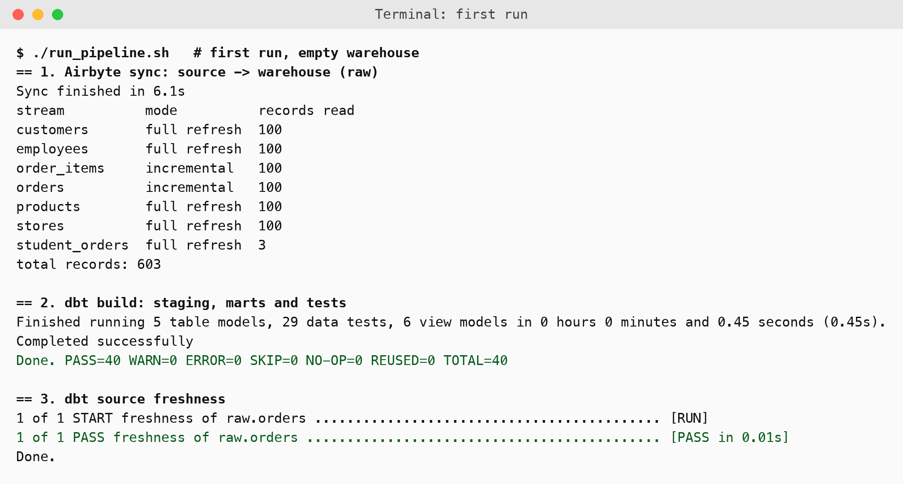
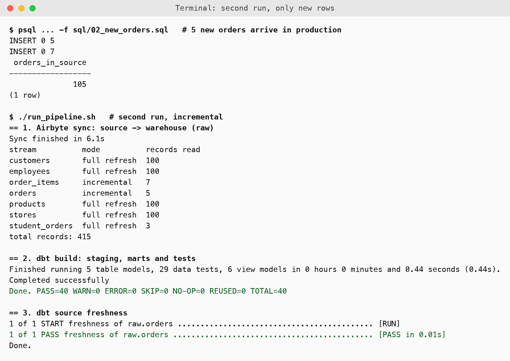
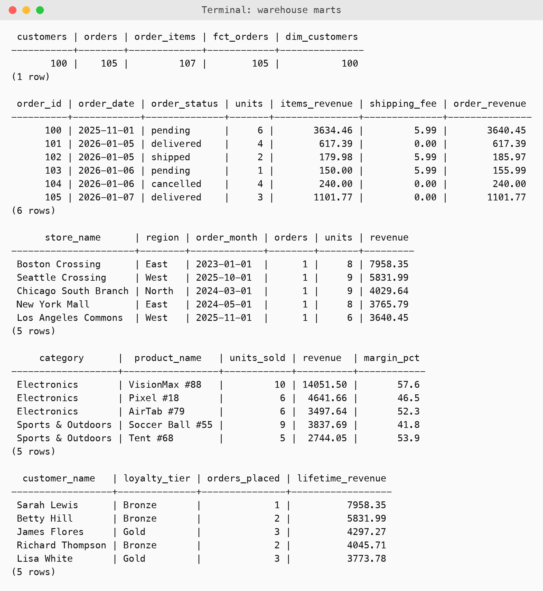
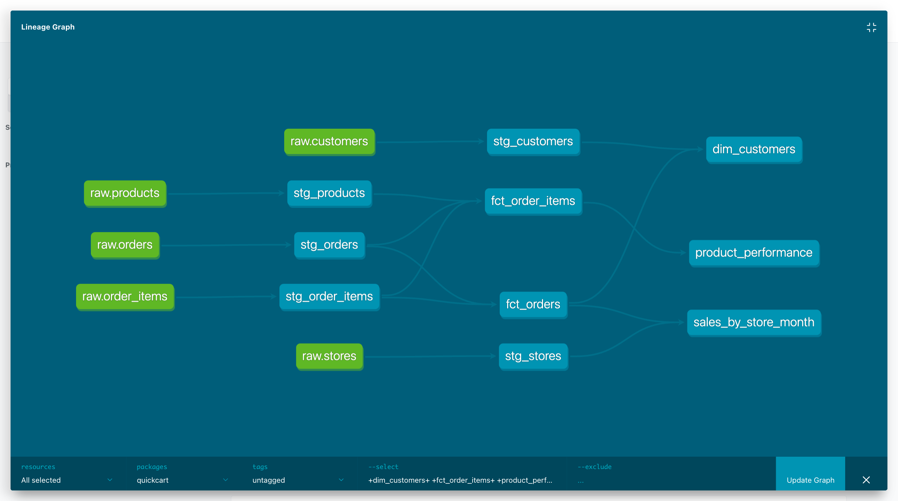
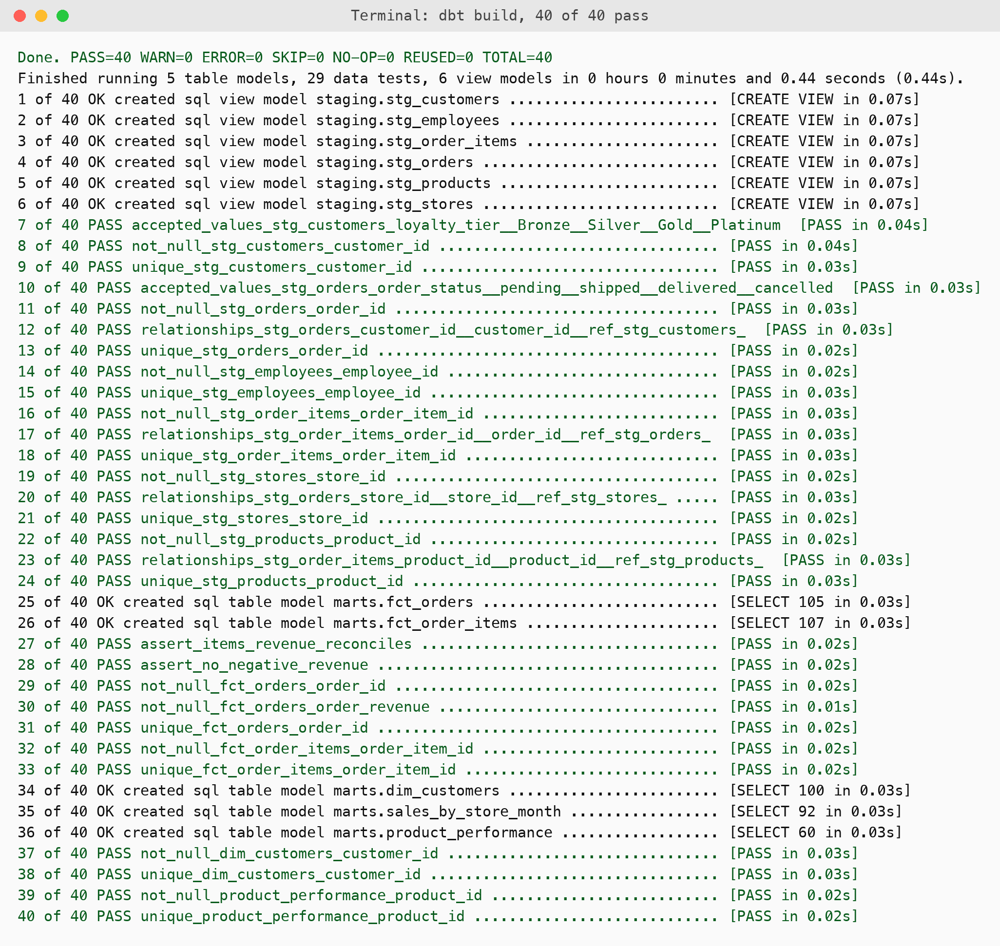

# QuickCart Ingestion: Airbyte OSS and dbt

QuickCart is a growing e-commerce company that needs an ingestion strategy. This repo contains two things:

1. A one page recommendation for the CTO: **Fivetran or Airbyte Open Source** (`docs/QuickCart_Ingestion_Recommendation.docx`).
2. A working proof of the recommended design: Airbyte's PostgreSQL connectors move data from a source database to a warehouse, and dbt turns the raw tables into tested reporting tables.

## The recommendation in short

**Use Airbyte Open Source, self-hosted on the AWS credits the company already has.**

| Constraint | Fivetran | Airbyte OSS | Better fit |
|---|---|---|---|
| 80M row updates a month in PostgreSQL | Billed per monthly active row, so cost grows with volume | No licence fee, runs on our own compute | Airbyte |
| Reports built once a day | Strong, but its value is frequent sync we do not need | One daily incremental sync is enough | Tie |
| Undocumented custom inventory API | No pre-built connector, custom code needed anyway | Connector Builder or Python CDK, we own the connector | Airbyte |
| One senior engineer and one junior | Fully managed | Self-hosted, someone must run it | Fivetran |
| Tight budget, spare EC2 and Kubernetes credits | New recurring spend | Uses credits we already have | Airbyte |

The real cost of Airbyte is operating it. The plan is for the junior engineer to own the deployment, keep it on one EC2 instance at first, write a runbook and alert on failed syncs. Fivetran stays as the fallback if the effort proves too high.

## What was built

```
 PostgreSQL source          Airbyte connectors             PostgreSQL warehouse              dbt
 quickcart_source   ->   source-postgres                ->   quickcart_warehouse     ->   staging views
 7 tables                destination-postgres                schema raw                    marts tables
 (orders, items, ...)    full refresh + incremental                                        40 tests
```

| Piece | What it is here | In the lab manuals |
|---|---|---|
| Source | Local PostgreSQL 16 in Docker, loaded from the six CSVs plus the `student_orders` demo table | Neon PostgreSQL |
| Ingestion | Airbyte's official `source-postgres` and `destination-postgres` connectors | Airbyte Cloud or Fivetran |
| Warehouse | A second database on the same PostgreSQL server | Snowflake |
| Transformation | dbt (dbt-core 1.12.6, dbt-postgres) | dbt |

### How the Airbyte part works

`airbyte/sync.py` runs the same steps the Airbyte platform runs for every sync:

1. `check` and `discover` ask the source connector what tables and columns exist.
2. A configured catalog chooses a sync mode per table. `orders` and `order_items` are **incremental** (cursor on the id, appended and deduplicated by primary key). The small lookup tables are **full refresh**.
3. `read` streams records out of the source and `write` loads them into the destination, which creates typed tables in the `raw` schema.
4. State is saved in `airbyte/state.json`, so the next run reads only rows newer than the last one.

The full Airbyte web platform needs several GB of images, and the laptop this was built on had under 10 GB of free disk. So the connectors were run directly from their Docker images. The connectors and the protocol are the real Airbyte ones, but there is no Airbyte web interface in this repo. In production the platform would add scheduling, retries and the UI on top of exactly this.

### The dbt project

- **Sources and staging** (`dbt/models/staging`): one view per raw table, with clean names, lowercase statuses and money cast to `numeric(12,2)`.
- **Marts** (`dbt/models/marts`): `fct_orders`, `fct_order_items`, `dim_customers`, `sales_by_store_month`, `product_performance`.
- **Tests** (40 in total): unique and not null keys, accepted values for status and loyalty tier, relationships between orders, customers, stores, items and products, and two custom tests (order revenue reconciles with the order lines, no negative revenue).
- **Source freshness** on `raw.orders`.

## Run it

Needs Docker, Python 3 and about 2.5 GB of disk for the connector images.

```bash
python3 -m venv .venv
# macOS python.org Python only: export SSL_CERT_FILE=$(python3 -c "import certifi;print(certifi.where())")
.venv/bin/pip install -r requirements.txt

docker pull airbyte/source-postgres:latest
docker pull airbyte/destination-postgres:latest

./setup_source.sh      # starts PostgreSQL on port 5440 and loads the CSVs
./run_pipeline.sh      # Airbyte sync, then dbt build and source freshness
```

To see the incremental sync, add new orders to the source and run again:

```bash
docker exec -i quickcart-pg psql -U quickcart -d quickcart_source < sql/02_new_orders.sql
./run_pipeline.sh
```

To browse the dbt documentation and lineage graph:

```bash
cd dbt && DBT_PROFILES_DIR=$PWD ../.venv/bin/dbt docs generate && DBT_PROFILES_DIR=$PWD ../.venv/bin/dbt docs serve
```

The database passwords in this repo are throwaway values for a local Docker container.

## Results

First run, empty warehouse: 603 records loaded and 40 of 40 dbt checks passed.



Second run, after 5 new orders and 7 new order lines were added to the source. Only those 12 rows are read for the two incremental tables, and the warehouse then holds 105 orders:



The reporting tables built by dbt:



The lineage graph, from raw tables through staging to the marts:



All 40 dbt checks:



Raw logs are in `evidence/`.

## Problems found along the way

- **Destination rejected the catalog.** The destination connector needs generation and sync ids that the Airbyte platform normally adds. `sync.py` now adds them.
- **Destination reported a source error.** The destination also needs the source's stream status messages. They are now forwarded.
- **Full refresh tables doubled on the second run.** A dbt `unique` test caught customers at 200 rows. A full refresh only replaces the old copy when each sync carries a newer generation id, so `sync.py` now sets one per sync.
- **Table swap failed because of dbt views.** Replacing a raw table failed while the staging views depended on it. The destination is set to `drop_cascade`, and dbt recreates the views right after in the same run.
- **State for full refresh tables.** Like the platform, `sync.py` keeps state only for incremental tables.

## Limits

- The warehouse is PostgreSQL, not Snowflake, and the source is a local container, not Neon, because those need cloud accounts. Pointing the connectors and dbt at Neon and Snowflake means changing the two config files in `airbyte/` and `dbt/profiles.yml`.
- The Fivetran manual was not run. It needs a Fivetran account.
- The custom inventory API in the brief has no documentation and no access, so it is covered in the recommendation but not built.
- The data is 100 rows per table, so this proves the design, not the 80M updates a month volume.
- A cursor based incremental sync does not see deleted rows. Log based change capture would, and it is the next step if deletes matter.

## Layout

```
airbyte/          connector configs and sync.py
dbt/              dbt project (models, tests, macros, profiles)
data/             the six CSV files
sql/              source schema and the new orders script
docs/             the recommendation
evidence/         raw logs of the runs
screenshots/      images used above
setup_source.sh   start and load the source database
run_pipeline.sh   one full run
```
